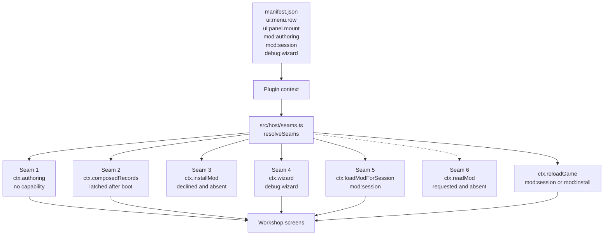

# The engine seams this mod needs



*Source of truth: `docs/ENGINE_SEAMS.md`, `src/host/seams.ts`, and `manifest.json`. The host refuses a mod that names a capability it does not know.*

Six seam decisions, each stated as a shape rather than a wish: what it is called,
what capability gates it, what it takes, what it returns, and what the mod does
when it is absent. Seams 1, 2, 4 and 5 are in Neo Angband 1.0.0. The install half
of seam 3 is deliberately not requested; its reload half is in the engine for a
mod that stages session content. Seam 6 is asked for and does not exist yet. The
compatibility fallbacks remain so the standalone preview and a partial test
context still render every screen.

The declared engine range starts at 1.22.0, the first build that runs a mod API 2
definition from a mod folder. On mod API 2 every seam is a call on the mod's
`manage` domain, and the manifest declares the capability each call needs:
`mod:authoring` for seam 1, `debug:wizard` for seam 4, `mod:session` for seam 5
and the reload, plus `ui:menu.row` for the way in and `ui:panel.mount` for the
page the workshop draws on. Seam 2 is `content.records`, which needs none.

The production route for this mod is concrete. Choosing the Build a mod row in the
Game menu runs `open` in `plugin.ts`, which calls `buildBuilderCtx`
(`src/host/api2-ctx.ts`). That function makes the `manage` and `content` calls
once, answers a refused call by leaving its member off, and returns the same
`BuilderCtx` shape the workshop has always read, so `seams.ts` and every screen
are unchanged. `open` then asks `ui.overlay` for a page and passes it to
`openWorkshop`.

**Reloading was not one of these when this was first written, and pretending it
was cost the try-it loop three steps.** Composing content takes a reload, so a mod
loaded for the session does not take effect until the page comes back. The
workshop used to say so and leave the player to press Ctrl-R, while holding a
`reload` it never called - which was reporting a restriction that did not exist. A
plugin's code runs in the page and can reach `location` with or without anybody's
permission, exactly as it can reach the document.

`ctx.reloadGame` is now a seam for the session case. It is gated by
`mod:install` or `mod:session`, not `mod:install` alone, and the session seam
(seam 5) prefers it over `location.reload()`: it is the engine's own
save-and-reload sequence - plugin teardown, autoplayer keyboard handback,
character write, session resume - rather than a bare page navigation that skips
the write and can drop the player at title/character-select instead of back into
play. `location.reload()` remains the fallback for a host with neither seam.

Two rules apply to all five:

- Each seam is read through one accessor in
  `src/host/seams.ts`, which returns either the real thing or a named fallback.
  No screen tests for a seam directly, so a seam landing changes one file.
- **A capability string the running engine does not recognise refuses the whole
  mod.** `parseCapability` throws on an unknown string and `CapabilitySet.fromManifest`
  propagates it, so `manifest.json` can only ever declare capabilities that
  already exist. A new capability therefore arrives here paired with an `engine`
  range starting at the release that carries it, which a player meets as "this
  needs a newer game" rather than as a mod that fails to load. The manifest
  declares `ui:menu.row`, `ui:panel.mount`, `mod:authoring`, `mod:session` and `debug:wizard`.

---

## Seam 1. `ctx.authoring` - the mod SDK, handed in - LANDED

These are pure functions over data the mod already holds, so they need no capability.
There is nothing to gate: no game state is reachable through them, no registry is
mutated, and every one of them is already reachable to anybody who can read the
published npm package.

```ts
/**
 * The mod SDK's public barrel, handed in the way `core` is handed in.
 *
 * Always present on the Neo Angband 1.0.0 plugin context.
 */
readonly authoring: ModAuthoringApi;

export type ModAuthoringApi = typeof import("@rpgm-tools/neo-angband-mod-sdk");
```

The workshop uses the whole barrel, not a hand-picked subset. Mod API 1 already
hands a plugin the engine's whole barrel, typed
`typeof import("@rpgm-tools/neo-angband-core")`, and the ratchet that watches
core's surface (`packages/core/mod-api-surface.json`) can watch this one the same
way. A hand-picked subset is a second list to maintain, and it falls behind the
first time somebody needs a function it left out. The SDK barrel already holds
back what it should: `applyFieldPolicy` stays out of `index.ts`, and a comment
there says why.

The workshop calls these functions through the surface:
rather than guessed at:

| Function | What the workshop does with it |
| --- | --- |
| `RECORD_BLUEPRINTS`, `BLUEPRINT_FILES`, `blueprintFor` | the content-kind list, and every field's measured shape, type set and range |
| `describeFile` | the one-line summary on each content kind |
| `fieldUsage`, `requiredFields` | how common a field is, which is what "expected" means on a field card |
| `templateRecord`, `draftRecord` | filling a new record with typical values rather than empty ones |
| `peersFor` | the evidence table: comparable records, and the sentence saying why they are comparable |
| `suggestFields` | a value plus the sentence explaining it |
| `checkRecords`, `COMPANION_RULES` | live validation, at the same three levels the running game uses |
| `ModProject`, `modProject` | assembling, validating and emitting the mod |
| `recordKey`, `recordRefKeys`, `keySpecFor`, `keyDescription` | the ref a record will be addressed by, shown at the moment the player names it |
| `validateManifest`, `ManifestError`, `PACK_GROUPS`, `slugify` | live checks on the mod's own id, name and version |
| `applyFieldPatch`, `composeFieldPatches`, `touchedFields` | previewing a patch, and reporting a same-field collision |
| `MOD_REQUIREMENTS`, `checkMod` | the requirement rows on the mod-details screen, so a refusal at install time is not the first the player hears of it |
| `danglingReferences`, `normalizeRef` | naming what else references a record before it is removed |
| `compareSemver`, `satisfies` | the engine range the emitted mod declares |

In production, `mod-context.ts` imports the SDK namespace once and places
it on every `modPluginContext` result unconditionally. Unlike composed records,
it does not wait for game boot because its functions are pure over caller-owned
data. `mod-authoring-surface.test.ts` pins the barrel and
`mod-authoring-seam.node.test.ts` calls it through the context.

Without this field, a standalone or compatibility context can still omit it from
ModForge's narrower `BuilderCtx`. `src/host/authoring-stub.ts` then implements
the same interface over a hand-written record set of a few dozen records and a
hand-written blueprint for four content kinds. Every screen renders and every
gesture works; the numbers are a demonstration and the workshop says so in a
banner it does not let the player dismiss. This is not the production path on a
supported game.

The advisory extension also landed. `RecordBlueprint` measures a closed set
of values for a field where core's data has one. `checkRecords` now reports an
unlisted value as the `field/vocabulary` hint. It is never an error because a mod
may legally coin a new tval or slay code, but it still catches a misspelled member
of an existing vocabulary. ModForge calls that checker over the composed draft
and no longer keeps a second `workshop/vocabulary` implementation.

One rejected alternative was for the mod to ship its own copy of the measured statistics,
regenerated from the installed SDK
at release time. That is roughly 300KB of duplicated payload, it drifts from the
engine the moment the engine's content changes, and it would still not supply
`checkRecords` or `ModProject` without reimplementing them - and a
reimplementation of the validator that disagreed with the game's own would be
worse than no validator, because it would be believed.

---

## Seam 2. `ctx.composedRecords` - the records the game was built from - LANDED

This is the same content the player already has, in the shape
it was read in. `ctx.registries` already publishes the bound result of exactly
this data with no capability, and this is strictly less than that: data rather
than live objects.

```ts
/**
 * Every content record the running game was composed from, as JSON, keyed by
 * pack-file stem with no extension: "monster", "object", "store".
 *
 * The BOUND form of the same content is `registries`. This is what the binder
 * read. Absent during content composition, for the same reason.
 */
readonly composedRecords?: Readonly<Record<string, readonly JsonRecord[]>>;
```

It is needed even though `ctx.registries` exists because the two have different shapes and
only one of them is what the authoring stack accepts. Every `records` parameter
in the SDK is `Readonly<Record<string, readonly JsonRecord[]>>` keyed by file
stem, and `peersFor`, `suggestFields`, `templateRecord`, `draftRecord` and
`checkRecords` all take it. `ctx.registries.monsters.races` is `MonsterRace[]`:
bound, resolved, and carrying neither the JSON key names nor the fields that
bound to nothing. A peer table built from bound races could not answer "what does
`base` say on the dogs near depth 3", because `base` is not a field on a bound
race.

In production, `packages/web/src/pack.ts` composes it and memoises the
result as `memo.composed`, alongside `packs`, `dropped` and `refused`. After the
game has booted, `main.ts` calls
`setModComposedRecords(composedObjects(composedRecords()))` beside the bound
registry latch. Every later `modPluginContext` reads that latch, and
`content.records(file)` answers from it for a mod on API 2. `composedObjects` is the SDK's own
narrowing of `Record<string, unknown[]>` to `ComposedRecords`, so the host and the
authoring functions agree about which passthrough elements are records.

The workshop depends on one property: mod-added records must be in it on the
same terms as core's, exactly as they are in `ctx.registries`. Basing a new sword
on another mod's sword acquires a dependency, and the workshop writes that
dependency at the moment the base is chosen. It can only do that if it can see
the other mod's records and knows who owns them, which the provenance field on a
composed record already carries.

Without it, during content composition or in a standalone or partial test
context, the field is honestly absent and ModForge's stub record set stands in.
Everything renders; nothing from that fallback is presented as evidence about
the running game. On the supported in-game path it is present by the time the player
can choose the menu row.

---

## Seam 3. `ctx.installMod` - install the bytes - DECLINED; reload LANDED

The install contract below records the evaluated shape. ModForge does not ask for `mod:install`, so the game never hands it `ctx.installMod`, and the workshop's install button stays off. The session-loading door already supplies the authoring loop without granting a mod permission to make another mod permanent. `ctx.reloadGame`, also recorded in this section, did land for callers holding `mod:session` or `mod:install`.

The `mod:install` capability would require a new string, a new arm in `parseCapability`, and a new arm
in `grantCovers`, new arm in `describeCapability` with elevated consent text. The
consent sentence has to say what it actually permits, which is that the mod may
put another mod into this install without the player visiting the mod manager.

```ts
/**
 * Install a mod from the bytes of a zip, exactly as importing a zip file does.
 *
 * Present only when the manifest declared `mod:install` and the player consented.
 */
readonly installMod?: (bytes: Uint8Array) => Promise<InstallModResult>;

export type InstallModResult =
  | { readonly ok: true; readonly id: string; readonly version: string; readonly lines: readonly string[] }
  | { readonly ok: false; readonly problem: string; readonly lines: readonly string[] };

/**
 * Save the game and reload, so a mod installed or staged this session takes effect.
 *
 * Gated by `mod:install` or `mod:session`, not `mod:install` alone: a mod that
 * stages content with seam 5 needs to follow it with a reload exactly as one that
 * installs does, and reloading without either is not something a mod has any
 * business doing.
 */
readonly reloadGame?: () => Promise<void>;
```

These notes describe the shape required by the existing path.

- `lines` carries the host's own wording. `installFailureLines`, `installOutcomeLines`,
  `requirementsRefusal` and `MOD_CHECK_ADVICE` already exist and are what a
  downloaded mod's failure reads like. A mod built here that fails a requirement
  must fail with the same words, or the player learns two vocabularies for one
  concept. Returning the lines rather than a code is what makes that free.
- `problem` is `InstallResult.problem` unchanged: one whole sentence.
- No `replace` option and no `force`. `installModFromZip` pins the origin on
  first import and refuses a later import whose repository disagrees, and that is
  correct: the workshop's job is to persist the repository string with the draft
  and never regenerate it, not to ask the engine to relax the rule.
- `installBlocked("third-party", allowed)` runs before the archive is opened, so
  the answer can be "third-party mods are switched off" before any work happens.
  The workshop checks this when it OPENS rather than when it installs, because a
  player who has spent twenty minutes on a monster and is then told to go and
  press a key on another screen has had a bad time.

Without it, the workshop writes the same bytes to a file the player
downloads, and points at the mod manager's existing zip-import door, which
already accepts exactly these bytes. That path costs two extra actions and is
otherwise identical, and it has one advantage worth keeping even after the seam
lands: the player ends up holding a file they can open, read, hand to somebody
and push to a repository. So the download button stays either way, and the seam
removes a round trip rather than unlocking a capability.

---

## Seam 4. `ctx.wizard` - the whole debug set, on a session that is not being saved

The `debug:wizard` capability landed in the engine. It is a separate string from
`debug:spawn` rather than a wider reading of it, because the two cost the player
different things and neither is a bigger helping of the other. The engine's
`grantCovers` compares the action, so one consent cannot buy both.

```ts
/**
 * The game's debug commands as METHODS, plus a catalogue of everything loaded.
 *
 * Present only when the manifest declared `debug:wizard`, the player consented,
 * and there is a live game. Every command refuses until `sandbox()` has cut the
 * session loose from its save slot, which cannot be undone.
 */
readonly wizard?: WizardApi;
```

The wired `WizardDeps` bundle would let the workshop call the engine's own
`wiz*` functions directly. Core exports everything a spawn needs except the deps
those functions take, and rebuilding `MakeDeps` from `ctx.registries` would give
the mod a fresh `ArtifactState` and create the Phial twice, so the bundle is the
shortest route. The method surface is used instead because it moves a guarantee
out of this repository and into the host.

What that shape could not do is stop a mistake here from reaching somebody's
character. Those functions are gated on a `debug` flag in a bag the CALLER
assembles, so the only thing between a bug in this repository and a cheated
character written over a real save was this repository's own care. A method surface
puts the rule in the host, where it is enforced instead of intended.

The host enforces the whole bargain. Not one command runs until
`sandbox()` has dropped the session's active save slot id. That id is the single
thing every write to a character consults - the turn-tail autosave, the level-change
save, `S`, the options screen, `pagehide` and the death save all end up there - so a
session without one writes nowhere. Detaching also throws a one-way latch in the
page's own memory, because the id itself lives in storage every tab shares. It
cannot be undone.

**So this grant is SAFER for the character on disk than `debug:spawn` is, not more
dangerous.** Spawning acts on the character the player is actually playing and costs
them that character's place on the high score list for good. This one refuses to
touch a character that is still being written down at all. The consent sentence says
so; describing it as "more debug commands" would have the risk exactly backwards.

This is also why the panel no longer refuses on somebody's behalf. The old
design had a fourth disabled reason: the character had not taken Angband's permanent
debug mark, and the workshop would not take it for them, correctly, because it cost
that character its scoring eligibility forever. Detaching first is a smaller thing to
spend and it is spent in the open, so the mark now lands on a character that has
already stopped being written down, where it is simply true. There is nothing left to
refuse for anybody.

The workshop uses it in these ways:

- It arranges the game around one record rather than only conjuring one. Testing a
  monster written for dungeon level forty means being on level forty; testing an item
  balanced for a hundred hit points means having them. The panel carries the depth
  jump, the experience and gold and stat edits, acquirement, summoning, banishment,
  mapping, lighting and lore, because that set is what one honest test takes.
- It says what testing costs, in the panel and not in a tooltip, naming the character
  who is about to stop being saved, before the button that spends it. That button is
  the only live control until it is pressed.
- It shows the author's own content first. Every catalogue entry carries the pack
  that added it, so the ordering needs no list of what the base game contains - a
  list that would be wrong the first time the game added a monster. It is **not**
  limited to the mod's own content: the filter turns off, and the record an author is
  modelling theirs on is the thing they most often want to test against.
- It reads the catalogue BEFORE anything is consented to, which is the one thing that
  works unarmed. Deciding what to test is how somebody decides whether to spend their
  session; a browser that filled in afterwards would ask them to agree to something
  they cannot see.
- It still spawns only records already in the composed game. It never spawns from an
  uncommitted draft and never asks the engine to recompose under a live game, which
  can invalidate references held by live entities and by generation code. The loop is
  forge, play, test - and forging and playing is now one button.

Without it, the Test panel still opens, with its controls off and the reason on screen. The setting may be off, the player may have refused `debug:wizard`, the game may have no such seam, or no game is running. A game that hands over the authoring library always has the seam, so there the reason given is the refused permission. The catalogue browser fills in whenever there is a game to read.

---

## Seam 5. `ctx.loadModForSession` - try it now, without keeping it

The `mod:session` capability landed in the engine. It is a separate string from
`mod:install` rather than a flag on it, because the two say different things to a
player: an install arrives switched off and waits to be turned on, and a session
load is on as soon as the game reloads. The engine's `grantCovers` compares the
action so neither consent sentence can be spent on the other.

`mod:session` belongs to the game's management permissions. Only the copy of ModForge installed from its own repository, with unchanged files, can hold it, and the game asks about it separately from the rest. Load ModForge from a folder or a zip and it runs without it.

```ts
/**
 * Load a mod for THIS SESSION only, from the bytes of a zip.
 *
 * Present only when the manifest declared `mod:session` and the player consented.
 */
readonly loadModForSession?: (bytes: Uint8Array) => Promise<SessionModResult>;

export type SessionModResult =
  | { readonly ok: true; readonly id: string; readonly version: string; readonly survivesReload: boolean }
  | { readonly ok: false; readonly problem: string };
```

This is the seam the workshop actually wanted. Seam 3 removes a round
trip; this removes the reason to hesitate. The loop an author is in is build,
look, change, look again, and every iteration of it through the install door
leaves another version of an unfinished mod in the library. A session load is the
same loop with nothing accumulating, which is what makes it usable more than once
an evening.

The shape has these properties.

- `survivesReload` is the one field a caller cannot work out for itself. A window
  with storage switched off takes the mod for this page and loses it on the way
  back up, so "reload to try it" would send the player round a loop that cannot
  finish. The workshop reads it and says to install instead.
- No `lines`. Unlike an install, there is no second vocabulary to match: a
  refusal here is `problem`, one whole sentence, and the archive is refused by the
  same functions the install door uses so the wording is already the game's.
- Content only, refused by name, on exactly the terms seam 3 is. The door refuses
  an archive holding a `.js`, `.mjs`, `.cjs`, `.ts` or `.wasm` at any depth, and
  refuses one whose manifest declares any capability. That is right, and it is the
  reason the seam is not a route by which any mod could get code to run without a
  player being asked.

  It costs the workshop something now, which it did not when this was written.
  The file editor can carry a hand-written `plugin.js`, so a mod made here is no
  longer content by construction. The button is therefore off for a mod that ships
  a script, with the reason on it, and the route for that mod is the file and the
  mod manager's own import door. Nothing is asked for here: consent belongs where
  the player is, and a mod that runs code should arrive through the door that says
  so. See `sessionRefusal` in `src/model/files.ts` - one function, asked by both
  buttons and by the action behind them, so a disabled control and the refusal
  behind it cannot drift apart.

Before it stages anything, the workshop says that trying it is not a
preview: the pack composes into the game exactly as an installed one does, so the
character who plays it keeps whatever it does to them, and next launch, with the
pack gone, that character's mod-owned monsters and items belong to something that
is not installed. "Only for this session" reads as a safety feature and is not
one, so the note under the button says the other half in the same breath.

Without it, the Try button is there but greyed out, with a note under it. If the game handed over the authoring library, the note says the workshop lacks the permission. Otherwise it says this game has no way to load a mod for one session, so trying one means installing it.

## Seam 6. `ctx.readMod` - a mod, read rather than installed

Forking needs a mod's files without putting that mod anywhere. Every door the
engine lends a mod today takes bytes in order to INSTALL them, and every door that
turns a reference into bytes is the host's own. So the one thing a fork wants -
"give me what that mod is, and change nothing" - has no shape on `ctx` at all.

```ts
/**
 * Read a mod without installing it: one already installed here, or one at a
 * repository address, resolved exactly as the mod manager's own door resolves it.
 *
 * The `installed` arm needs no capability. It returns what the mod manager
 * already shows the player about a mod they already have, and less about its
 * content than `ctx.composedRecords` does. The `repository` arm is gated by
 * `mod:read`, because that one goes to the network on the player's behalf.
 */
readonly readMod?: (ref: ReadModRef) => Promise<ReadModResult>;

export type ReadModRef =
  | { readonly kind: "installed"; readonly id: string }
  | { readonly kind: "repository"; readonly address: string };

export type ReadModResult =
  | {
      readonly ok: true;
      readonly manifest: PackManifest;
      /** Every file the mod folder carries, by path relative to its root. */
      readonly files: Readonly<Record<string, Uint8Array>>;
      /** Where it came from, in the same words an install would pin. */
      readonly origin: string;
    }
  | { readonly ok: false; readonly problem: string };
```

The shape has these properties.

- **It returns the folder, not a draft.** Turning a mod folder into an editable
  draft is this repository's work and is done: `src/model/fork.ts` reads a folder
  through the same `files.ts` parser that reads a file the author typed. What it
  cannot do is get the folder.
- **`manifest` is separate from `files` even though `files` contains it**, because
  the manifest the host validated is the manifest the host would install, and a
  second parse here could disagree with it about a key. The mod reads the parsed
  one and ships the raw one.
- **`problem` is one whole sentence, the host's own.** A repository that refuses,
  a tag that no engine here can run, a mod the standards check would fail: a fork
  must fail with the same words an install fails with, or a player learns two
  vocabularies for one concept.
- **No `force`, no `replace`, nothing that writes.** This seam reads. The fork it
  feeds is a new mod with an id of its own, and nothing about it touches the mod
  it read.

Without it, the workshop does two different partial things, and neither is a
substitute for the seam.

For a mod ALREADY INSTALLED, it reads the content out of `ctx.composedRecords`.
Every composed record names the pack that owns it and the packs that have touched
it, so the set of mods in the game and the records each one contributed can be
recovered from provenance alone, and a record another mod has since patched can be
restored to its owner's own version from the same stamp. What provenance cannot
carry is anything a manifest says, so a fork taken this way arrives with no name,
no description, no author, and no LICENCE - which is the one that matters, since
forking somebody's content does not come with permission to relicense it. The
workshop says so in as many words and asks for a licence before the mod is shared.

For a mod at a REPOSITORY ADDRESS, it refuses, and says to install the mod first
or to download its folder and pick it. Resolving a repository is a real piece of
work the host already owns - the tag list, the update channel filter, the manifest
read at each candidate tag until one is compatible, the declared `payload` or the
repository's file listing filtered by a deny-list - and none of it is on `ctx`.
Nothing stops a plugin making the same network requests itself, since a plugin
runs in the page. What stops this one is that a second implementation of that
resolution would disagree with the first, quietly, in the direction of accepting a
mod the install door would refuse. That is the same reasoning that keeps this mod
from shipping its own copy of the record validator under seam 1: a reimplementation
that disagrees with the game's own is worse than none, because it is believed.

## What is deliberately not asked for

A `ui:dom.overlay` capability was an earlier shape of this design, and it is not
requested. On mod API 2 a first-party in-process mod gets `ui.overlay`, which
makes a modal page with a closed shadow root, stacks it over the game and draws
the host's own close button in the corner the page names (`closeAt`, the bottom right here), and the workshop builds into that page under
`ui:panel.mount`. A host that will not make one (a test, a refusal) leaves the
workshop to draw its own element on the document, as it did before.

What the page does not do is the one thing the mod cannot do properly for
itself: the host clearing held-key and pointer-button state as the overlay takes
and releases input, so that closing the workshop with a key held does not move
the character. The mod's own capture-phase listeners get most of the way there
and cannot get that far, since the browser's own hardware auto-repeat for a
still-held key is not something any amount of listener bookkeeping in this
mod's script can reach. What the listeners CAN do, and now do, is set right the
one thing that is honestly theirs to fix: `src/ui/overlay.ts` tracks a key or
pointer button it has seen go down without a matching release while it owns
input, and sends the game an honest keyup or mouseup for one on acquire and on
release, so the game is never left believing something is held that it can no
longer hear the release of. That narrows the edge case; it does not close it.
Implemented in `src/ui/overlay.ts`, with the remaining browser-level edge case
described above.

A menu-row dispatch seam is not needed. The way in is a row in the Game menu,
registered with `ui.gameMenu.register` under `ui:menu.row`.

A live content-preview seam was considered and rejected; the reasoning is under
seam 4.

Binary emit is not an engine seam: `EmittedFile.contents` is
now `string | Uint8Array` rather than only `string`, which is a change entirely
on this repository's side of the boundary and asks the engine for nothing new.
A tile, a font or a sound is a hand-carried extra whose bytes are held exactly
as given, through the file editor, the project builder's emit path and the zip
writer alike; a record file and the manifest stay text, unaffected. Loading a
shipped binary asset back into the running game remains a question about an
engine seam, not about whether the workshop can emit the bytes.
